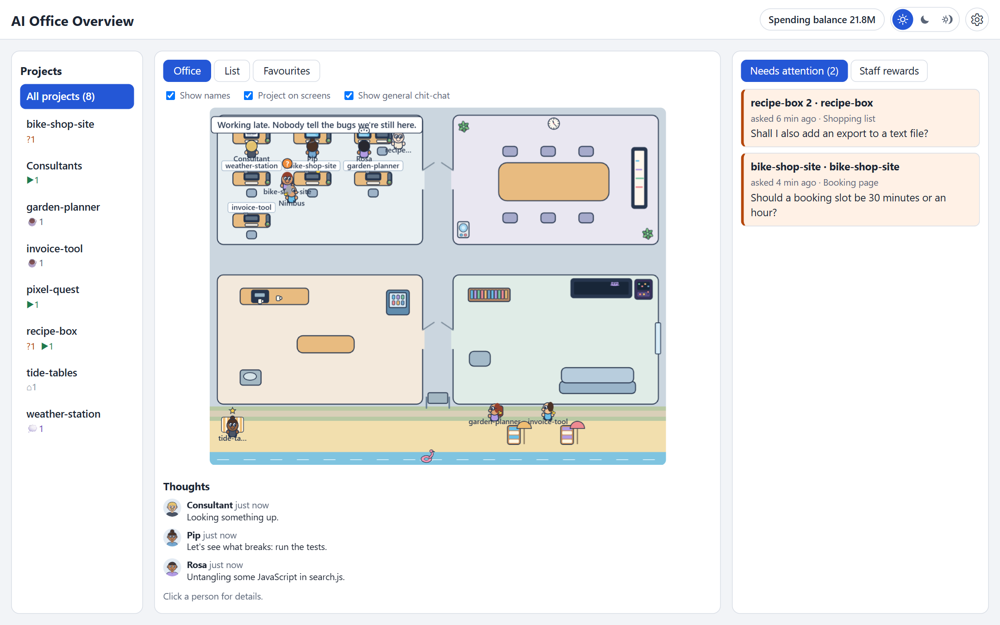
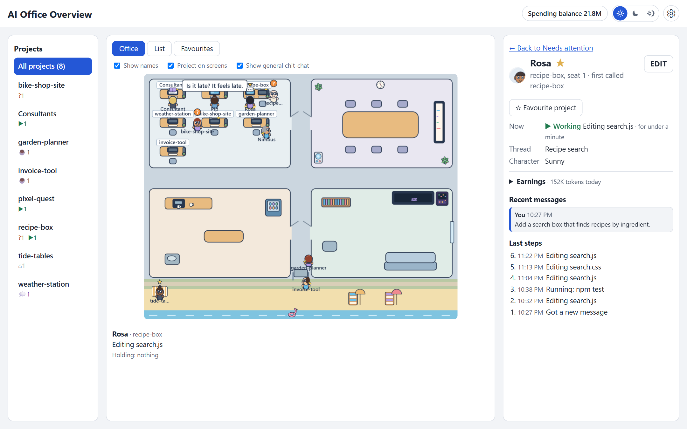
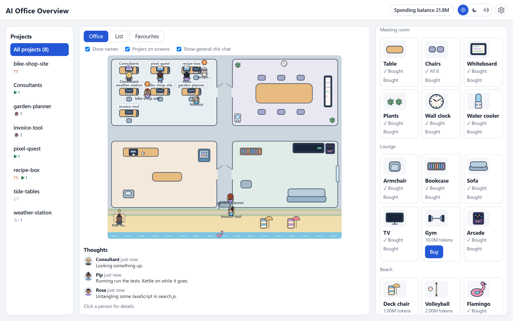
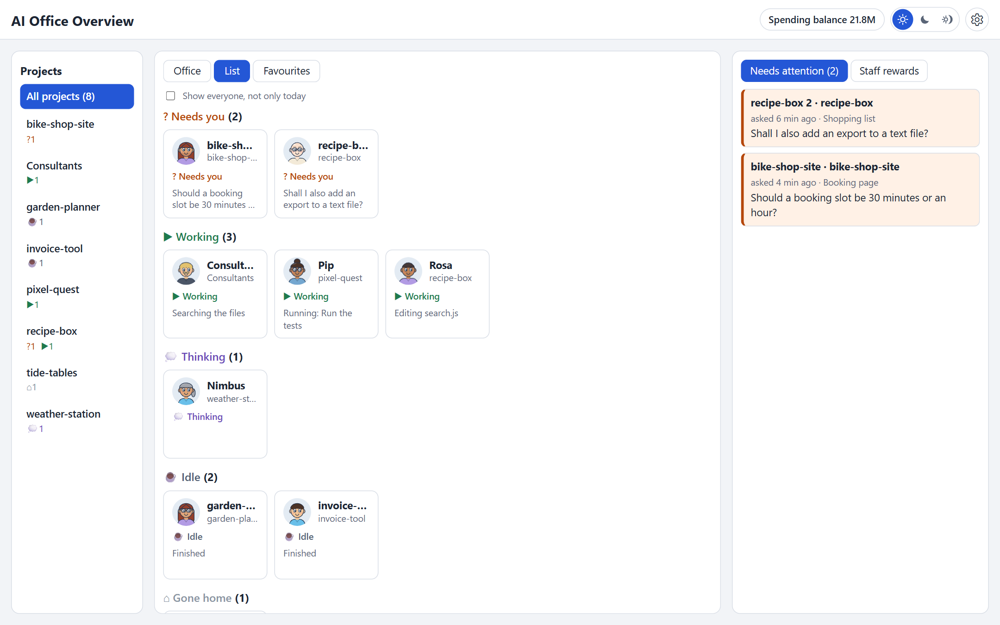
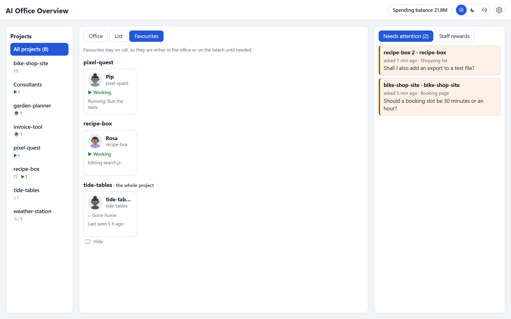

# AI Office Overview

**See your Claude Code threads as staff in a little office, on your own PC.**

For people who run several Claude Code threads at once and want to see at a glance which are working, which are
thinking and which are waiting for an answer. Each thread is a little person at their project's desk: working,
thinking in the meeting room, standing up with a "?" when they need you, resting when they have finished, and going
home when they have gone quiet. The tokens your staff write can be spent on furnishing the office.

It runs on your PC only. It reads the transcripts Claude Code already keeps, never changes them and never sends them
anywhere.



*The office (made-up data). Each thread is a person at their project's desk. Two stand with a "?" because they asked
you something, and Needs attention on the right lists them, longest waiting first. Thoughts, under the office, is
the staff's chat about what their threads are doing.*

## Which one is for you?

There are two versions of the office. Pick one:

| | What it is | What it needs | What leaves your PC |
|---|---|---|---|
| **AI Office Overview** (this one) | **The office only**: your threads as staff, Needs attention, Favourites, Staff rewards and the Thoughts chat | Node.js 20 or newer (made for Windows; the installer brings its own Node.js) | Nothing (GitHub only when you press Setup › Update › Check) |
| **[AI Head Office Overview](https://github.com/Matthew4509/ai-head-office-overview)** | The office **plus project tools**: a tile per project to run its local copy, git and live-site marks, a security audit, backups, prompts and a project planner | Windows 10 or 11 with Edge, Node.js 22 or newer | Plain checks of the live addresses you add; GitHub when you check for updates |

Both read the transcripts Claude Code already keeps. Both are independent projects, not made by Anthropic.

**Quick start:** download the installer from the [Releases page](https://github.com/Matthew4509/ai-office-overview/releases)
and run it, or with Node.js 20 or newer:

```
git clone https://github.com/Matthew4509/ai-office-overview.git
cd ai-office-overview
node server.mjs --open
```

Nothing to install from npm: it has no dependencies.

## Install it

Three ways, each for your Windows user only (no administrator needed):

- **The installer** (easiest): download `AI-Office-Overview-Setup-<version>.exe` from the
  [Releases page](https://github.com/Matthew4509/ai-office-overview/releases) and run it. It brings its own copy of
  Node.js, puts the office in the Start menu, offers a desktop shortcut and Start with Windows, and starts the office.
  Windows SmartScreen says "unknown publisher" the first time (More info, then Run anyway): the installer is not
  code-signed. The office then appears under Settings › Apps, where Uninstall stops it, takes its hooks out of Claude's
  settings, removes the shortcuts and the program, and asks before deleting the data folder. **It does not update
  itself**: for a newer version, download the newer installer and run it over the old one (your data folder is kept).
  Setup › Update says so.
- **install.cmd** in a copy of this folder (`git clone https://github.com/Matthew4509/ai-office-overview.git`, or a
  zip): it checks Node.js 20 or newer (and offers to install it with winget), puts the office in the Start menu, asks
  about a desktop shortcut and Start with Windows, and starts the office. Setup › Setup in the office does the
  shortcuts too. **uninstall.cmd** undoes it (so does Setup › About › Uninstall): the office stops, the shortcuts go and
  the hooks come out; the folder stays for you to delete. Each copy (a clone, a zip, the installed one) takes away
  only its own shortcuts and hooks: another copy's are left, and a shortcut that starts another copy is not taken over. A copy made with `git clone` updates itself from Setup ›
  Update; a zip does not (download the newer zip and copy your data folder across).
- **Nothing at all**: with Node.js 20 or newer, double-click **Start AI Office Overview.cmd**, or run `node server.mjs`.

It is made for Windows. On macOS or Linux `node server.mjs` runs the office and its page, with no shortcuts, installer
or Open in Claude button (not tested there).

## Start it

Double-click **Start AI Office Overview.cmd** (or its shortcut), or run:

```
node server.mjs --open
```

The page opens by itself once the office is ready (without `--open`, go to http://127.0.0.1:8860/). The very first start reads all
your Claude transcripts once, which can take a minute: keep the window open (a shortcut keeps it minimised). Later
starts take about a second. The first start also opens the office: the spending balance counts from then on. Starting it a second
time over the same data folder says it is already running and stops. `node server.mjs --status` says whether it runs,
and `node server.mjs --stop` stops it (uninstall.cmd and the installer use this). Setup › About › Quit stops it too.

## Screenshots

All made-up data: invented projects, no real threads.



*A person's card. Click anyone in the office (or a tile in List) to see their project and seat, what they are doing
now and for how long, their thread, today's tokens under Earnings, their recent messages and last steps. The star makes
them a favourite; EDIT changes their name and look.*



*Staff rewards. The tokens Claude writes become a spending balance. Here the meeting room and the lounge are unlocked
and furnished (table, chairs, whiteboard, clock, sofa, TV, arcade machine), and the gym and volleyball set are still
for sale.*



*List: the same office in words, grouped by what each person is doing, with what they asked or what they are working
on.*



*Favourites: starred people, and whole favourite projects. A favourite who goes home waits on a beach towel instead
of leaving (bottom left of the office picture above).*

## Easy or advanced setup

- **Easy** (the default): the office reads the transcripts every 3 seconds. Nothing in Claude is changed. "Needs you"
  is worked out from the last reply, and a permission prompt may not show.
- **Advanced** (Setup › Setup › Turn on advanced setup): adds three hooks to Claude Code's settings file
  (`~/.claude/settings.json`): on a new message, a permission prompt, and a finished reply. Claude then tells the office
  straight away. Hooks you already have stay as they are, a copy of the file is saved first, and Go back to easy setup
  takes out only the office's three. Each hook runs `hook.mjs`, which sends only to 127.0.0.1 and prints nothing. In a
  copy put here by the installer, the hooks run its own Node.js (`node\node.exe`), so the PC needs no other.
  It is refused when the office's folder path holds a `$`, a backtick, a `"` or a `%`, which the hook runner would read
  as part of a command: move the office to a plainer folder first.

## Updating

Setup › Update › **Check for a newer version** asks GitHub once (nothing about you is sent) and lists what is new.
**Update now** takes it and restarts the office; your `data/` folder is never touched. It works for a copy made with
`git clone https://github.com/Matthew4509/ai-office-overview.git`; a downloaded zip cannot update itself (download the
new one and copy your `data/` folder across), and a copy put on the PC by the installer takes the newest installer from
the Releases page instead (your `data/` folder is kept). It refuses, and changes nothing, when files in the folder were
changed, when this copy has saved changes of its own, or when it would replace a file of yours that git ignores. A test
copy (started with `AI_OFFICE_DATA` or `AI_OFFICE_TRANSCRIPTS` set) never updates. Restart waits while an update is
being taken.

## What you see

- **Top bar:** the title goes back to the office with all projects; **Spending balance** opens Staff rewards; the sun,
  moon and auto buttons pick light, dark, or Auto (light from sunrise to sunset, worked out from this PC's time zone,
  so nothing is asked online); the gear opens **Setup**, with the tabs Setup (the shortcuts, easy or advanced setup),
  Office (theme, the Thoughts chat, the projects folder, the gone-home time), Update, Help and About (version, Quit,
  Uninstall).
- **Projects** (left): All projects, then every project with a thread today and how many people are working,
  thinking, need you or have finished. Click one to show only that project.
- **Office, List and Favourites** (middle): the page opens on the office (an address ending `#list` or `#favourites`
  opens that tab). The ticks under the tabs, **Show names**, **Project on screens** and **Show general chit-chat**,
  are kept in this browser. Click a person to open their card. List shows everyone as tiles, about five across.
- **Needs attention** (right, first tab): every thread whose last reply asked you something, longest waiting first.
  Press "Answered: take off the list" on the card once you have dealt with it; it comes back if they ask again.
- **A person's card:** their name with a **star** (a favourite) and **EDIT** (name and look; both belong to the seat),
  **Open in Claude** (opens the thread in the Claude desktop app, when the app has a record of it), project and seat,
  what they are doing and for how long, recent messages, last steps, what they asked, and **Earnings** (today's tokens;
  it opens to their helpers and their tokens today, since the office opened, before it and in all).
- **Favourites:** star a person on their card, or everyone in their project with **Favourite project**. A favourite who
  goes home lies on a beach towel until their next thread starts. The star belongs to the seat, so the next thread in
  that seat is a favourite too. **Hide** takes a favourite who has gone home off the tab and the beach.
- **Staff rewards** (right, second tab): the shop. The lounge (10M tokens) and the meeting room (20M) start locked,
  dark with a padlock; click one to unlock it. Treats come to the kitchen, furniture is carried in, and the staff try
  out what is new. Buy everything and treat the team to each treat once, and the trophy case arrives.
- **In the office:** the arcade machine (once bought) plays Tetris, Lunar Lander or Moon Rover; the vending machine
  (1M-token coin) gives everyone an energy drink, and for a minute they move three times as fast; rubber ducks go to
  meetings; the wall clock keeps the real time.
- **Thoughts** (beside or under the office): the office chat. Each seat has a character, with lines for what really
  happened in a thread: tests passed or failed, a commit, a push, the same file edited again, a stopped reply, a bug
  found. The lines use the kind of event and the short step the card shows (a file's name, a command's or a helper's one-line description), never your messages or Claude's replies. **Setup › Office ›
  Thoughts chat** picks Everything, Work only or Off.

## The rules

- **The projects folder** is the one set in Setup. Until one is set, the office guesses it from where threads started:
  the folder most of them started in or, when they started in sibling folders (Claude opened in each project's own
  folder), the folder those sit in.
- **One person per thread.** Their desk is the project folder they write files in. With no files written yet, it is
  the folder their first message says START HERE in, then the folder they are working in.
- **Consultants.** Work in the projects folder itself, or in two or more projects (an audit), makes a Consultant.
- **Seats keep the name.** The first thread in a folder sits in seat 1 and is called after the folder. A second thread
  there at the same time is seat 2 ("ai office overview 2"), sitting at the same desk on an extended table. Change nickname
  names a seat for good: the next handover thread in that folder sits in the lowest free seat and is that person again.
- **Gone home.** After an hour with nothing happening (Setup can change this) a thread goes home and frees its seat. If
  its last reply asked something, it stays on Needs attention (marked gone home) for up to 7 days.
- **Thinking.** A thread waiting on Claude for 15 seconds or more is thinking. Once the meeting room has a table, a long
  think goes there, and everyone who has finished comes to help.
- **Helpers** (subagents) earn for their thread only when they write files or run commands that change something.
- **Deleted threads.** A thread deleted in Claude keeps its person, nickname and tokens: the office keeps its own record
  in `data/`.
- **The spending balance** is every output token Claude writes from the day the office opened, less what was spent. Prices are
  TOMLIN's x 20, scaled to the output tokens a day of Claude Code work writes.

## Helping someone set it up

Agents (Claude and others) helping a user, for example to turn on advanced setup (hooks): read **AGENTS.md** first.

## Files

- `server.mjs`: the small server (127.0.0.1:8860 only; the page also opens as http://localhost:8860/, which is the same
  PC). Every request from the page carries a key made when the office
  starts (a page from an earlier run reloads itself); the hook route takes a plain JSON event instead.
- `src/transcript.mjs` reads one transcript; `src/people.mjs` has the folder, seat and state rules; `src/office.mjs`
  keeps the ledger and makes the snapshot; `src/shop.mjs` is the shop; `src/setup.mjs` does easy and advanced setup;
  `src/update.mjs` is Setup › Update; `src/install.mjs` is the shortcuts and uninstall; `src/windows.mjs` (with
  `src/windows/shortcut.ps1`) is every call the office makes to Windows itself.
- `public/`: the page. `office.js` and `look.js` are adapted from TOMLIN's office and staff looks;
  `banter.js` has the office chat's characters and lines; `sun.js` works out sunrise and sunset for the Auto colours
  (the server runs it too, so the page comes in its colours); `arcade.js` is the arcade machine's three games;
  `setup.js` is the Setup window; `app.ico` is the shortcuts' and installer's icon (made from `icon.svg` by
  `node tools/make-icon.mjs`).
- `hook.mjs`: the advanced-setup hook.
- `install.cmd`, `uninstall.cmd` and `tools/setup.mjs`: the shortcuts, set up and taken away from the console.
- `installer/`: the Windows installer. `installer\build.cmd` stages the files with this PC's Node.js and its licence (the one beside
  node.exe, or else `installer\node-LICENSE`, a local copy kept out of git; with neither it stops and says where to get
  it), and builds `installer\out\AI-Office-Overview-Setup-<version>.exe` with Inno Setup 6
  (`winget install --id JRSoftware.InnoSetup -e`). The installer refuses a folder whose path holds `$`, `%`, a backtick
  or `"`.
- `AGENTS.md` (and `CLAUDE.md`, which points Claude Code to it): how an agent helps set up hooks safely.
- `data/` (made on first start, not shipped): settings, nicknames, the ledger, purchases, and where each transcript was
  read to.
- `test/`: `npm test` (Node.js 20 or newer; `tools/run-tests.mjs` lists the test files, and
  `node tools/run-tests.mjs test/shop.test.mjs` runs only those named).
- `tools/head-office-check.mjs`: compares this app with AI Head Office Overview's office, which is the main copy.
  `tools/head-office-differences.json` lists every difference left, each marked as on purpose, to bring here, or ahead
  here. Run `node tools/head-office-check.mjs [path to Head Office's office folder]`: it says "Everything left is on the
  list", or names what changed since. `--show <file>` prints one file's differences, and `--accept <file>` records them
  once sorted.

## Settings for testing

- `PORT`: default 8860.
- `AI_OFFICE_DATA`: the office's own folder (default `data/`). Use a scratch folder to look without opening the
  office.
- `AI_OFFICE_TRANSCRIPTS`: where the transcripts are (default `~/.claude/projects`).
- `AI_OFFICE_SETTINGS`: the Claude settings file advanced setup changes (default `~/.claude/settings.json`). Point it
  at a copy when testing.
- `AI_OFFICE_APP_SESSIONS`: where the Claude desktop app's thread records are read from (the Open in Claude button).
  Point it at an empty folder when testing.
- `AI_OFFICE_SHORTCUT_DIR`: a folder to make the shortcuts in instead of the real Start menu, desktop and Startup
  folders (the tests use a temp one).
- `AI_OFFICE_OPEN=0`: `--open` opens no browser. `AI_OFFICE_INSTALL_NO_START=1`: install.cmd does not start the office
  and uninstall.cmd does not pause. `AI_OFFICE_UPDATE_TEST=1`: a test copy may run Setup › Update (the update tests).
- `HEAD_OFFICE`: the path of AI Head Office Overview's office folder for `tools/head-office-check.mjs`.

## Licence

AI Office Overview is under the **PolyForm Noncommercial License 1.0.0** (the full text is in [LICENSE](LICENSE)). In
plain words: you may use it, change it and share it for any noncommercial purpose, such as personal use, a hobby,
study or research, or in a charity, school or public body. Commercial use is not licensed. Anyone you share it with
must get the licence and its `Required Notice:` line too. It is source-available, not open source, which is why GitHub
shows the licence as "Other".

The office drawing and the staff looks come from TOMLIN, by the same owner, under the same licence.

The installer brings a copy of [Node.js](https://nodejs.org) (MIT licence) in `node\node.exe`. Its licence, which also
covers the libraries built into it (OpenSSL, ICU, V8, libuv and others), is beside it in `node\LICENSE`.
